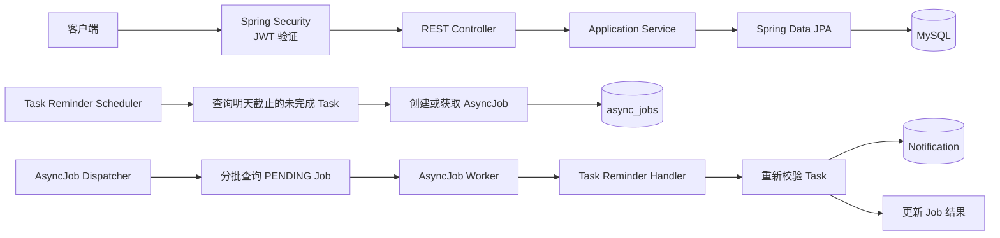

# Task API

一个基于 Spring Boot 的多用户任务管理与站内提醒系统。

项目围绕真实的任务生命周期展开：用户通过 JWT 完成身份认证并管理自己的任务；系统根据任务截止日期创建持久化后台作业，通过状态机、事务、唯一约束和乐观锁保证提醒处理的正确性，最终为任务所属用户生成站内通知。

## 核心能力

- 用户注册与登录
  - BCrypt 密码哈希
  - HS256 JWT 签发与验证
  - 无状态 Spring Security 认证

- 多用户数据隔离
  - Task 绑定所属用户
  - Notification 绑定接收用户
  - 用户只能访问自己的任务和通知
  - 对不存在和不属于当前用户的资源统一返回 404，避免泄露资源信息

- 任务生命周期
  - Task CRUD 与分页查询
  - `TODO → IN_PROGRESS → COMPLETED` 状态机
  - STARTED、COMPLETED 领域事件
  - 状态变化与事件写入处于同一事务

- 并发控制
  - 使用 `@Version` 实现乐观锁
  - 客户端更新时携带预期版本
  - 通过真实并发测试验证冲突行为

- 截止日期提醒
  - 每天扫描第二天截止且未完成的任务
  - 使用持久化 `AsyncJob` 表达后台作业
  - 通过业务唯一键防止重复创建提醒作业
  - Worker 执行前重新校验任务状态、截止日期和提醒窗口
  - 支持 `SUCCESS`、`FAILED`、`SKIPPED` 等明确处理结果

- 后台作业调度
  - Dispatcher 分批查询最早的 PENDING Job
  - 每批最多处理 20 条
  - 单个 Job 失败不会阻止后续 Job
  - 每个 Job 独立处理，Dispatcher 不使用事务包裹整批任务

- 站内通知
  - 提醒作业成功后生成 Notification
  - 通知状态使用 `UNREAD / READ`
  - 支持分页查询与幂等标记已读
  - 同一个 AsyncJob 最多生成一条 Notification

- 数据库管理
  - MySQL 开发环境与 H2 测试环境
  - Flyway V1～V9 管理数据库演进
  - Hibernate `ddl-auto=validate` 校验实体与真实数据库结构

## 技术栈

| 分类 | 技术 |
|---|---|
| Language | Java 17 |
| Framework | Spring Boot 4.1.0 |
| Web | Spring MVC、Bean Validation |
| Persistence | Spring Data JPA、Hibernate |
| Security | Spring Security、OAuth2 Resource Server、JWT、BCrypt |
| Database | MySQL 8.4、H2 |
| Migration | Flyway |
| Scheduling | Spring Scheduling |
| Build | Maven |
| Testing | JUnit 5、Mockito、MockMvc、Spring Boot Test |

## 系统架构



系统包含两条主要执行链路。

### HTTP 请求链路

```text
Client
→ Spring Security 验证 JWT
→ Controller 从 JWT subject 提取当前用户 ID
→ Service 执行业务与资源归属校验
→ Repository 访问数据库
```

客户端不能通过请求体指定 `ownerId` 或 `recipientId`。任务归属来自已经验证的 JWT；后台提醒执行时没有当前登录用户，因此 Notification 的接收者来自 `Task.ownerId`。

### 后台提醒链路

```text
TaskReminderScheduler
→ 查询截止日期为明天的 TODO / IN_PROGRESS Task
→ 创建 PENDING AsyncJob
→ AsyncJobDispatcher 分批获取 Job ID
→ AsyncJobWorker 将 Job 切换为 RUNNING
→ TaskReminderJobHandler 重新校验业务条件
→ 创建 Notification
→ AsyncJob 进入 SUCCESS / FAILED / SKIPPED
```

Scheduler 负责发现业务条件，Dispatcher 负责编排待处理作业，Worker 负责作业生命周期，Handler 负责具体提醒业务。不同职责没有集中到一个大型 Service 中。

## 关键设计决策

### 1. 资源归属来自 JWT，而不是请求参数

Task 的 `ownerId` 和 Notification 的 `recipientId` 都不能由客户端在 JSON 中指定。Controller 从已经验证的 JWT `subject` 中取得当前用户 ID，Service 再使用 `ownerId + resourceId` 查询资源。

对于不存在和不属于当前用户的资源，系统统一返回 404。这样既实现了数据隔离，也避免向用户泄露其他用户的资源是否存在。

### 2. 应用层预查询与数据库唯一约束共同保证幂等

提醒作业的业务唯一键为：

```text
(task_id, job_type, reminder_stage, target_deadline)
```

它表达：同一个 Task 针对同一个截止日期，在同一个提醒阶段只能创建一个同类型 Job。

应用层先查询已有 Job，用于避免正常串行流程中的无意义插入；数据库唯一约束负责处理并发事务同时通过预查询的竞争情况。预查询改善正常流程，唯一约束提供最终正确性保障。

Notification 使用 `UNIQUE(async_job_id)`，保证同一个 AsyncJob 最多生成一条站内通知。

### 3. targetDeadline 是业务快照

AsyncJob 创建时保存 `targetDeadline`，而不是只在执行时读取 Task 当前的 deadline。这样 Job 能够保留“它最初针对哪个截止日期产生”的业务语义。

如果用户之后修改了 Task deadline，Worker 会发现当前 deadline 与 `job.targetDeadline` 不一致，并将旧 Job 标记为：

```text
SKIPPED / DEADLINE_CHANGED
```

旧 Job 不会继续生成已经失效的提醒；新的 deadline 在满足条件时可以产生新的 Job。

### 4. Worker 执行前必须重新校验业务条件

Scheduler 找到的 Task 只代表创建 Job 时满足条件。Job 真正执行时，Task 可能已经发生变化，因此 Handler 会重新检查：

- Task 是否仍然存在；
- Task 是否仍为 `TODO` 或 `IN_PROGRESS`；
- Task 当前 deadline 是否仍等于 `targetDeadline`；
- 当前日期是否仍符合 `ONE_DAY_BEFORE` 提醒窗口。

不再满足条件属于业务失效，记录为 `SKIPPED`；程序契约错误或处理异常记录为 `FAILED`。二者不会混为同一种结果。

### 5. 事务边界围绕业务结果设计

- Task 状态变化与 TaskEvent 写入处于同一事务；
- Job 启动使用独立事务提交 `RUNNING`；
- Handler 在一个事务中创建 Notification 并将 Job 更新为 `SUCCESS`；
- 如果 Handler 失败，该事务整体回滚，再通过独立事务记录 `FAILED`；
- NotificationService 使用 `MANDATORY`，要求调用方必须已经建立事务。

因此不会出现“Notification 已提交但 Job 仍然显示处理失败”的部分提交状态。

### 6. 乐观锁处理并发修改

Task、AsyncJob、Notification 和 AppUser 使用 `@Version`。Hibernate 更新时会同时检查记录 ID 和预期版本：

```sql
UPDATE ...
SET version = version + 1
WHERE id = ?
  AND version = ?;
```

如果另一个事务已经修改了同一记录，旧版本更新不到任何行，Hibernate 将其转换为乐观锁异常。项目通过真实并发测试验证了 Task 状态竞争，而不是只验证单线程下的版本号变化。

### 7. 当前后台作业的运行边界

当前版本明确采用以下运行模型：

```text
单个应用实例
一个 Dispatcher
串行调用 Worker
数据库持久化 Job
```

`fixedDelay` 保证同一 Dispatcher 的下一轮在上一轮结束后再启动；Dispatcher 每轮查询第 0 页最多 20 条 PENDING Job，并在单个 Job 抛出异常时继续处理后续 Job。

当前没有实现多应用实例之间的原子领取，也没有实现 RUNNING Job 的超时恢复。如果进程在 Job 已提交 RUNNING 后异常退出，该 Job 可能停留在 RUNNING。这是后续扩展点，不在当前版本中通过 Redis 锁或消息队列进行伪装式解决。

### 8. 为什么当前没有引入 RabbitMQ 和 Redis

当前规模下，数据库持久化 Job 已经能够展示状态机、事务、幂等、失败分类和调度编排。直接加入消息队列还需要同时解决数据库与消息的双写一致性、ACK/NACK、重试、死信队列和 Outbox 等问题。

因此当前版本选择先把数据库驱动的后台作业闭环做完整。未来如果需要多实例消费、更高吞吐量或外部通知投递，再在清晰的业务需求下引入消息队列；AsyncJob 仍可作为业务执行与审计记录保留。

## API 概览

除注册和登录外，其余接口都需要携带：

```http
Authorization: Bearer <access-token>
```

### 认证

| Method | Path | 说明 |
|---|---|---|
| POST | `/auth/register` | 注册用户 |
| POST | `/auth/login` | 验证邮箱和密码并签发 JWT |

注册与登录请求：

```json
{
  "email": "alice@example.com",
  "password": "Password123"
}
```

登录成功响应：

```json
{
  "accessToken": "eyJ...",
  "tokenType": "Bearer"
}
```

### Task

| Method | Path | 说明 |
|---|---|---|
| POST | `/tasks` | 创建当前用户的 Task |
| GET | `/tasks` | 分页查询当前用户的 Task |
| GET | `/tasks/{id}` | 查询当前用户的指定 Task |
| PUT | `/tasks/{id}` | 使用预期版本更新 Task 内容 |
| DELETE | `/tasks/{id}` | 删除当前用户的 Task |
| POST | `/tasks/{id}/start` | `TODO → IN_PROGRESS` |
| POST | `/tasks/{id}/complete` | `IN_PROGRESS → COMPLETED` |

创建 Task：

```json
{
  "title": "Prepare report",
  "description": "Complete before deadline",
  "priority": "MEDIUM",
  "deadline": "2026-10-30"
}
```

更新 Task 时需要携带客户端上次读取到的版本：

```json
{
  "title": "Prepare final report",
  "description": "Include review feedback",
  "version": 0
}
```

分页查询支持：

```text
GET /tasks?page=0&size=10
GET /tasks?status=IN_PROGRESS&page=0&size=10
```

未指定状态时按照业务优先级 `HIGH → MEDIUM → LOW` 排序；指定状态时按照 Task ID 升序返回。接口不接受客户端自定义 `sort`，避免覆盖服务端定义的业务排序。

### Notification

| Method | Path | 说明 |
|---|---|---|
| GET | `/notifications` | 分页查询当前用户的通知，最新通知优先 |
| POST | `/notifications/{id}/read` | 幂等地将指定通知标记为 READ |

重复调用标记已读接口不会重复改变状态或更新时间。

## 本地运行

### 环境要求

- Java 17
- MySQL 8.x
- Maven Wrapper（项目已包含）

### 1. 创建数据库

登录 MySQL 后执行：

```sql
CREATE DATABASE task_db
    CHARACTER SET utf8mb4
    COLLATE utf8mb4_0900_ai_ci;
```

只需要创建空数据库。应用启动后，Flyway 会按照 V1～V9 自动创建和演进表结构。

### 2. 设置环境变量

在 Windows PowerShell 中设置数据库密码：

```powershell
$env:DB_PASSWORD = "your-mysql-password"
```

JWT 使用至少 32 字节的随机密钥。可以在 PowerShell 中生成 Base64 密钥：

```powershell
$jwtBytes = New-Object byte[] 32
$rng = [System.Security.Cryptography.RandomNumberGenerator]::Create()
$rng.GetBytes($jwtBytes)
$rng.Dispose()

$env:JWT_SECRET = [Convert]::ToBase64String($jwtBytes)
```

环境变量只在当前 PowerShell 会话中有效，不要把真实密码或 JWT 密钥提交到 Git。

### 3. 启动开发环境

```powershell
.\mvnw.cmd spring-boot:run "-Dspring-boot.run.profiles=dev"
```

dev Profile 使用：

- MySQL `task_db`；
- Flyway migration；
- Hibernate `ddl-auto=validate`；
- 每天 09:00 执行提醒条件扫描；
- Dispatcher 每轮结束 5 秒后查询下一批 PENDING Job。

看到以下日志表示应用已经成功启动：

```text
Started TaskApiApplication
```

## 测试策略

测试环境使用 H2，不连接本地 MySQL，并关闭 Flyway 与真实定时调度。

当前测试覆盖的重点包括：

- Task 和 AsyncJob 状态机；
- Entity 与 Repository 映射；
- 数据库唯一约束；
- 用户注册、密码哈希与 JWT；
- Task 和 Notification 的跨用户隔离；
- Task 状态变化与 TaskEvent 的事务一致性；
- 真实并发下的乐观锁冲突；
- Reminder Job 的创建条件与串行幂等；
- Worker 的成功、跳过、失败及事务回滚；
- Dispatcher 的批次参数、处理顺序与异常隔离；
- Controller 与 Spring Security 的集成。

运行全量测试：

```powershell
.\mvnw.cmd test
```

当前测试结果：

```text
Tests run: 47
Failures: 0
Errors: 0
```
